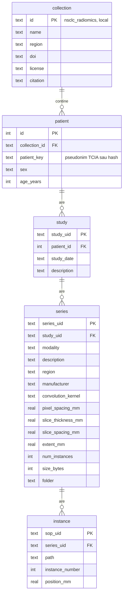

# Baza de date

DICOM3D tine un catalog local al studiilor CT intr-o baza de date **SQLite** (un singur
fisier, `catalog.sqlite`, fara server). Catalogul retine pacientii, studiile, seriile si
fisierele DICOM, cu metadatele lor anonimizate, iar seria se alege din interfata
(butonul **Bază de date**, Ctrl+B) in loc sa fie cautata de fiecare data prin foldere.

Pe langa seriile proprii, catalogul vine cu **18 serii CT reale** de la **18 pacienti**
din patru colectii publice ale The Cancer Imaging Archive (TCIA). Seriile se descarca
o singura data (~1,2 GB), din aplicatie sau din linia de comanda.

## Datele reale

| Colectie | Regiune | Serii | Licenta | Ce contine |
|---|---|---|---|---|
| [NSCLC-Radiomics](https://doi.org/10.7937/K9/TCIA.2015.PF0M9REI) | torace | 8 | CC BY-NC 3.0 | CT de planificare pentru cancer pulmonar (non-small cell), felii de 3 mm; include LUNG1-157, seria folosita pana acum |
| [LIDC-IDRI](https://doi.org/10.7937/K9/TCIA.2015.LO9QL9SX) | torace | 4 | CC BY 3.0 | CT toracic diagnostic si de screening, nodului pulmonari adnotati de radiologi, 2,5–3 mm |
| [Pancreas-CT](https://doi.org/10.7937/K9/TCIA.2016.TNB1KQBU) | abdomen | 3 | CC BY 3.0 | CT abdominal cu contrast (faza venoasa portala), pas de 1 mm intre felii |
| [HCC-TACE-Seg](https://doi.org/10.7937/TCIA.5FNA-0924) | abdomen | 3 | CC BY 4.0 | CT de ficat (carcinom hepatocelular), multifazic, 2,5 mm |

Lista exacta (pacient, UID-uri, numar de felii, marime) este in
`src/dicom3d/catalog/colectii_tcia.json`. Toate seriile au fost descarcate si incarcate
in aplicatie la construirea catalogului: niciuna nu are felii lipsa sau duplicate.
O serie candidata (HCC_002) a fost scoasa pentru ca avea doua faze de contrast amestecate
in aceeasi serie (109 felii cu aceeasi pozitie), lucru pe care verificarea din
`SliceSampling` l-a semnalat.

**De unde vin.** TCIA publica datele, anonimizate, sub licente Creative Commons. Copia
folosita de aplicatie este cea din [NCI Imaging Data Commons](https://imaging.datacommons.cancer.gov)
(IDC), care tine colectiile TCIA in containere publice Amazon S3: descarcarea nu cere cont,
cheie sau aplicatie separata (NBIA Data Retriever). Manifestul a fost generat din indexul
oficial IDC (`idc-index-data` 25.0.5) cu `scripts/genereaza_manifest_tcia.py`: cate o serie
CT axiala pe pacient, 80–300 de felii, fara reconstructii sagitale/coronale, MIP sau topograme.

**Licente.** CC BY si CC BY-NC cer citarea colectiei in orice lucrare care foloseste
datele; CC BY-NC (NSCLC-Radiomics) interzice in plus folosirea comerciala, ceea ce nu
afecteaza o lucrare de licenta. Citarea fiecarei colectii apare in aplicatie sub tabel,
cand alegi o serie, si cu `dicom3d-db colectii`. Fisierele DICOM nu se urca in repo.

### Citari (de trecut in bibliografia lucrarii)

- Aerts, H. J. W. L. et al. (2019). *Data From NSCLC-Radiomics* (Version 4) [Data set]. The Cancer Imaging Archive. https://doi.org/10.7937/K9/TCIA.2015.PF0M9REI
- Armato III, S. G. et al. (2015). *Data From LIDC-IDRI* (Version 4) [Data set]. The Cancer Imaging Archive. https://doi.org/10.7937/K9/TCIA.2015.LO9QL9SX
- Roth, H. et al. (2016). *Data From Pancreas-CT* (Version 2) [Data set]. The Cancer Imaging Archive. https://doi.org/10.7937/K9/TCIA.2016.TNB1KQBU
- Moawad, A. W. et al. (2021). *Multimodality annotated HCC cases with and without advanced imaging segmentation* (Version 1) [Data set]. The Cancer Imaging Archive. https://doi.org/10.7937/TCIA.5FNA-0924
- Clark, K. et al. (2013). The Cancer Imaging Archive (TCIA): Maintaining and Operating a Public Information Repository. *Journal of Digital Imaging*, 26(6), 1045–1057. https://doi.org/10.1007/s10278-013-9622-7
- Fedorov, A. et al. (2023). National Cancer Institute Imaging Data Commons: Toward Transparency, Reproducibility, and Scalability in Imaging Artificial Intelligence. *RadioGraphics*, 43(12). https://doi.org/10.1148/rg.230180

## Schema

Tabelele urmeaza ierarhia DICOM, plus colectia publica din care provine seria:



- `instance.position_mm` este pozitia feliei pe normala la plan (produsul scalar dintre
  Image Position Patient si normala din Image Orientation Patient). Catalogul sorteaza
  fisierele dupa ea, asa ca deschiderea unei serii nu mai cere o cautare GDCM prin folder.
- `series.slice_spacing_mm` este pasul median real dintre felii, iar `slice_thickness_mm`
  grosimea nominala din antet; pot diferi (vezi `docs/structura-datelor.md`).
- Vederea `v_series` aduna pe un rand seria, studiul, pacientul si colectia; pe ea se fac
  cautarea si filtrele din interfata.
- Cheile straine au `ON DELETE CASCADE`: stergerea unei serii ii sterge fisierele din
  catalog (nu de pe disc), iar pacientii si studiile ramase fara serii se curata.

Codul este in `src/dicom3d/catalog/`: `db.py` (schema si interogarile), `indexer.py`
(citirea antetelor cu pydicom, fara pixeli), `download.py` (descarcarea din IDC),
`cli.py` (linia de comanda).

## Anonimizare

Baza de date nu contine numele pacientului, data nasterii sau ID-ul real:

- pentru colectiile TCIA se pastreaza pseudonimul publicat de arhiva (ex. `LUNG1-157`),
  ca un caz sa poata fi citat si regasit;
- pentru seriile proprii, `patient_key` este `P-` + primele 10 caractere hex din SHA-256
  al ID-ului: seriile aceluiasi pacient raman grupate, dar ID-ul nu se poate citi;
- se pastreaza doar sexul si varsta in ani, utile pentru descrierea lotului de date.

Fisierele DICOM proprii raman neschimbate pe disc; catalogul doar trimite la ele.

## Folosire

Catalogul si datele descarcate stau in `Documente\DICOM3D` (`catalog.sqlite` si `date\`).
Variabila de mediu `DICOM3D_HOME` le muta in alt loc (de exemplu pe alt disc).

In aplicatie: **Bază de date** (Ctrl+B) deschide lista; **Descarcă seriile TCIA** aduce
seriile care lipsesc, **Adaugă folder…** indexeaza un folder propriu, iar dublu clic sau
**Deschide seria** incarca seria aleasa. Orice serie deschisa cu **Deschide serie** (Ctrl+O)
intra automat in catalog.

Din linia de comanda:

```powershell
dicom3d-db descarca --simulare            # ce s-ar descarca: 18 serii, ~1,2 GB
dicom3d-db descarca                       # toate
dicom3d-db descarca --colectie lidc_idri --max 2
dicom3d-db indexeaza C:\date\CT --regiune torace
dicom3d-db lista --regiune abdomen
dicom3d-db stare
dicom3d-db colectii                       # licentele si citarile
```

Descarcarea se poate opri si relua: fisierele deja descarcate complet se sar, iar
fiecare fisier se scrie intai ca `.part` si se redenumeste doar dupa ce marimea se
potriveste cu cea din S3.
