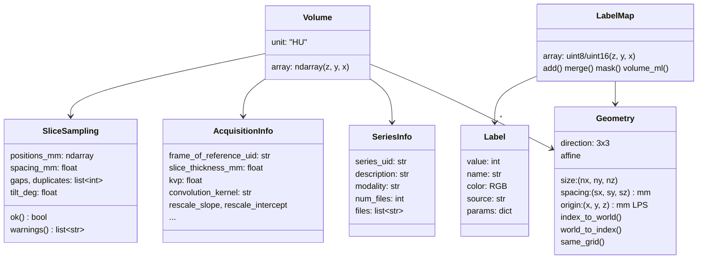

# Structura datelor

Acest document descrie cum reprezinta DICOM3D datele, de la fisierele DICOM de pe disc
pana la modelul 3D exportat. Toate structurile sunt in pachetul `dicom3d.data`; restul
aplicatiei (incarcare, segmentare, mesh, interfata) lucreaza doar cu ele.

## Pe scurt

```
folder DICOM ──find_series──▶ SeriesInfo ──load_series──▶ Volume ──segmentare──▶ LabelMap ──Marching Cubes──▶ mesh (STL)
                                                           │                       │
                                                           ├─ Geometry ◀───────────┘ (aceeasi grila)
                                                           ├─ AcquisitionInfo
                                                           └─ SliceSampling
```

| Structura | Ce contine | Fisier |
|---|---|---|
| `SeriesInfo` | o serie gasita pe disc: UID, descriere, modalitate, lista de fisiere sortate | `data/metadata.py` |
| `AcquisitionInfo` | parametrii de achizitie: kVp, kernel, grosimea feliei, rescale, Frame of Reference... | `data/metadata.py` |
| `SliceSampling` | pozitiile reale ale feliilor si verificarea lor (goluri, duplicate, pas, inclinare) | `data/metadata.py` |
| `Geometry` | grila de voxeli in spatiul pacientului: dimensiune, spatiere, origine, directie | `data/geometry.py` |
| `Volume` | intensitatile (HU) + `Geometry` + metadatele de mai sus | `data/volume.py` |
| `Label`, `LabelMap` | rezultatul segmentarii: o eticheta intreaga per voxel + tabelul structurilor | `data/segmentation.py` |
| `ReconstructionResult` | `LabelMap` + structura reconstruita + mesh + statistici | `pipeline.py` |



## Sisteme de coordonate

Aceasta este partea care se greseste cel mai usor, asa ca e fixata intr-un singur loc
(`Geometry`) si folosita peste tot.

**Indici de voxel.** Un voxel are indicii `(i, j, k)` = (coloana, rand, felie), adica
`(x, y, z)`. Array-urile numpy sunt in ordinea inversa, `array[k, j, i]` = `(z, y, x)`,
pentru ca asa le da SimpleITK si asa le asteapta VTK (x variaza cel mai repede in memorie).
De aceea `Geometry.size` este `(nx, ny, nz)`, iar `Geometry.shape` este `(nz, ny, nx)`.

**Coordonatele pacientului.** Sunt in milimetri, in conventia **LPS** a standardului DICOM:

| axa | creste spre |
|---|---|
| +x | stanga pacientului (Left) |
| +y | spatele pacientului (Posterior) |
| +z | capul pacientului (Superior) |

Programele care folosesc RAS (3D Slicer, de exemplu) au x si y cu semn schimbat.

**Legatura dintre ele.** Pozitia centrului voxelului `(i, j, k)` este

```
p = origin + D · diag(spacing) · (i, j, k)ᵀ
```

unde `origin` este centrul voxelului `(0, 0, 0)` (ImagePositionPatient al primei felii),
`spacing` este distanta dintre centrele voxelilor vecini (PixelSpacing si pasul dintre felii)
si `D` este matricea de directie: coloanele ei sunt directiile in care cresc `i`, `j`, `k`
(primele doua vin din ImageOrientationPatient, a treia este normala feliei).
Aceeasi transformare, ca matrice omogena 4×4, este `Geometry.affine`.

`Geometry.axis_codes()` rezuma orientarea in trei litere: `"LPS"` pentru o serie axiala
obisnuita, `"RAS"` daca primele doua axe sunt intoarse etc. `obliquity_deg()` spune cat de
departe sunt axele grilei de axele anatomice (0 la o serie axiala dreapta).

**Modelul 3D** este exportat direct in coordonatele pacientului (mm, LPS), deci se suprapune
cu seria originala in orice program care citeste DICOM.

## Volumul

`Volume.array` contine valorile deja rescalate, `valoare = brut · RescaleSlope + RescaleIntercept`.
La CT rezultatul este in unitati Hounsfield (aer ≈ −1000, apa = 0, os > 250). Tipul este
`int16` cand valorile sunt intregi (jumatate din memoria unui `float32`), altfel `float32`.

`Volume.spacing`, `origin`, `direction` si `shape_xyz` sunt scurtaturi catre `Volume.geometry`.
`Volume.value_at(xyz_mm)` intoarce valoarea voxelului cel mai apropiat de un punct din
spatiul pacientului.

## Metadate de achizitie

`AcquisitionInfo` se citeste din prima felie. Campurile importante pentru etapele urmatoare:

- `slice_thickness_mm` este grosimea **nominala** a feliei, nu distanta dintre felii. Cand
  grosimea este mai mare decat pasul, feliile se suprapun (`SliceSampling.overlap`); asta
  e normal la CT si influenteaza cat de fin poate fi modelul pe axa z.
- `convolution_kernel` (ex. `B30f` = tesut moale, `B70f` = os) schimba zgomotul si
  claritatea marginilor, deci si pragurile bune.
- `kvp` influenteaza valorile HU ale tesuturilor dense.
- `frame_of_reference_uid`: doua serii cu acelasi UID sunt in acelasi sistem de coordonate
  si se pot suprapune direct (fuziune) fara inregistrare.

Structurile **nu** contin nume, ID sau data nasterii pacientului: aplicatia nu are nevoie
de ele, iar rezultatele se pot folosi in lucrare fara anonimizare separata.

## Verificarea feliilor (`SliceSampling`)

Un volum presupune felii paralele, egal distantate. SimpleITK construieste volumul si
cand seria nu respecta asta, dar atunci anatomia iese deformata. La incarcare se citeste
pozitia fiecarei felii (ImagePositionPatient), se proiecteaza pe normala feliei si se
verifica:

| problema | cum se detecteaza | efect asupra modelului |
|---|---|---|
| felii lipsa | un pas > 1,5 × pasul median (`gaps`) | structura comprimata pe z |
| felii duplicate | doi pasi la < 0,001 mm (`duplicates`) | structura alungita pe z |
| pas variabil | abatere > 1 % fata de mediana | deformare locala pe z |
| gantry inclinat | unghi > 0,5° intre directia stivei si normala (`tilt_deg`) | volum forfecat |

Interfata afiseaza aceste probleme in bara de stare cand se incarca seria
(`SliceSampling.warnings()`).

## Segmentarea (`LabelMap`)

Rezultatul segmentarii este o harta de etichete pe **aceeasi grila** ca volumul: un intreg
pe voxel, 0 = fundal, `1..N` = structuri. Fiecare structura are un `Label`:

- `value`: numarul din voxeli
- `name`, `color`: cum apare in interfata si in rapoarte
- `source`: metoda care a produs-o (`"prag"` acum; `"manual"`, `"ai:totalsegmentator"` mai tarziu)
- `params`: parametrii metodei (pragurile, netezirea...), pentru reproductibilitate

De ce o harta de etichete si nu cate o masca binara: toate structurile stau intr-un singur
array `uint8` (pana la 255 de organe, apoi `uint16`), nu se pot suprapune din greseala, si
este formatul folosit de nnU-Net si TotalSegmentator. `LabelMap.merge()` combina rezultatele
mai multor metode (ex. oasele prin prag + organele dintr-o retea neurala); refuza hartile
care nu sunt pe aceeasi grila (`Geometry.same_grid`), ca sa nu se suprapuna voxeli din
locuri diferite. `LabelMap.mask(value)` da masca binara a unei singure structuri, din care
se genereaza suprafata 3D.

## Ce urmeaza (cum se extinde)

- **Volume mai apropiate de realitate:** reesantionarea la voxeli izotropi si interpolarea
  intre felii pornesc de la `Geometry` (grila noua) si `SliceSampling` (stim unde sunt
  feliile reale si cat de groase sunt).
- **Segmentarea organelor:** un model AI produce un `LabelMap` cu etichetele lui; numele si
  culorile intra in `Label`, metoda in `Label.source`.
- **Fuziune:** serii diferite (CT + PET, CT cu si fara contrast) se aduc pe aceeasi grila
  folosind `Geometry` si `frame_of_reference_uid`, apoi hartile se combina cu `merge()`.
